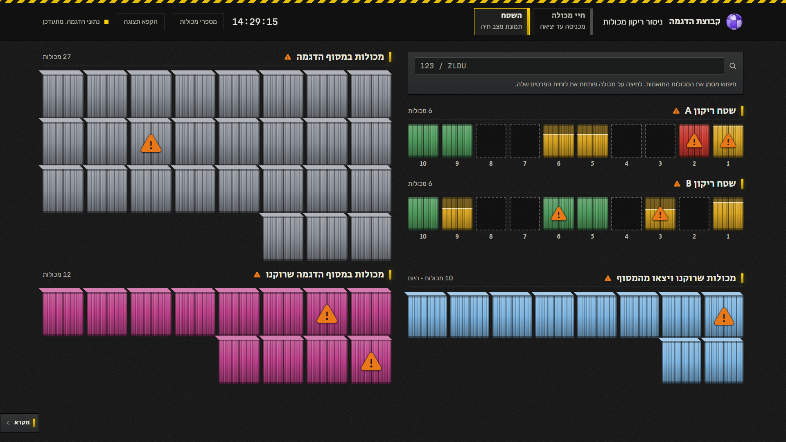
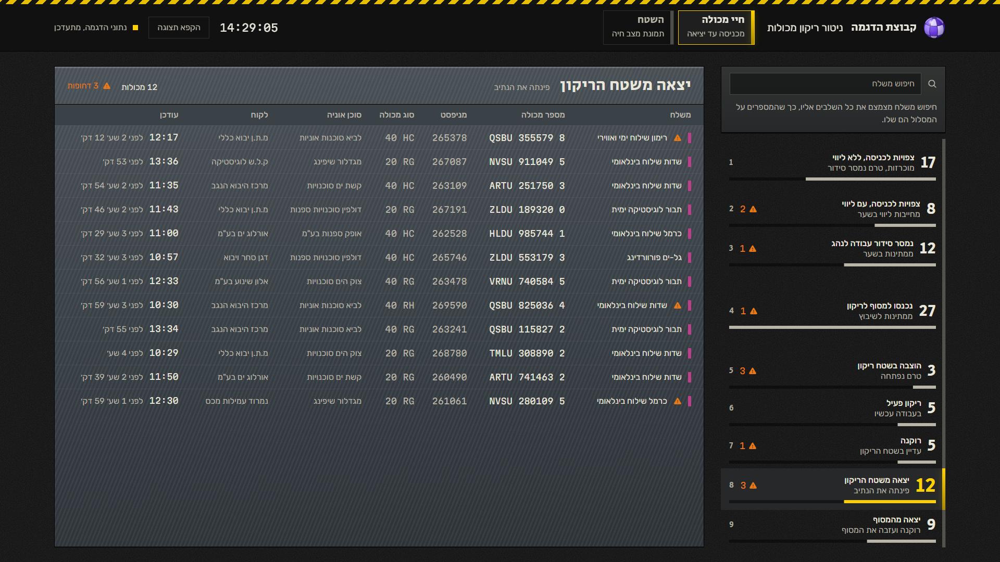
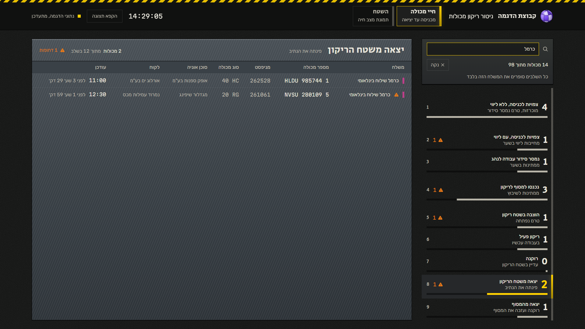
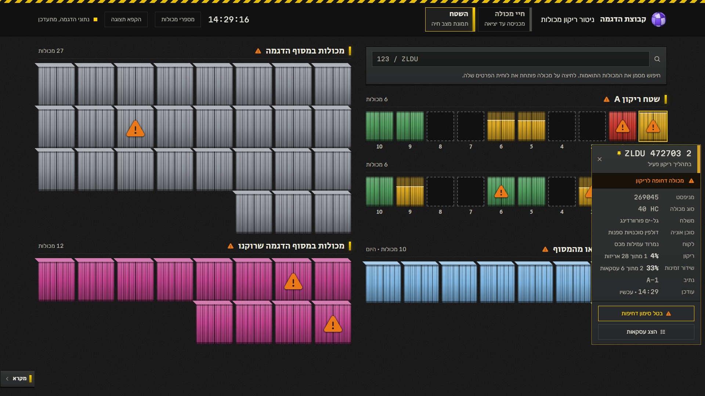
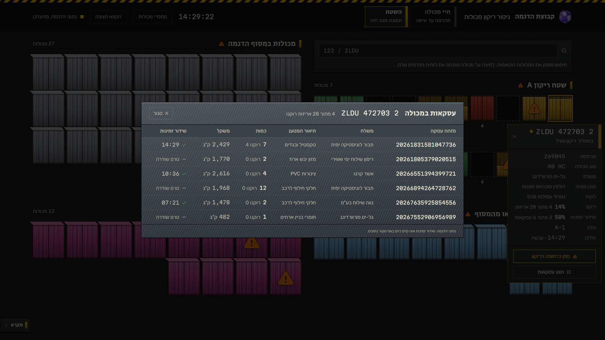

# Emptying monitor: a control-room wall screen for a container terminal

A live board for the team that empties import containers at a terminal: where every container is,
from the moment it's announced until it leaves, and what's happening in the two emptying areas right
now. Hebrew and right-to-left, built to be read from a few metres away on a wall screen over a whole
shift, and still clicked on up close.

**[Live demo →](https://MrCuteFace.github.io/emptying-monitor/)**: it moves on its own, about every four seconds.

I built this as a working prototype for a logistics company's operations. The real feed wasn't
connected yet, so the server runs an in-memory simulation; this public version runs the same
simulation in the browser. Every container number, shipper, agent, customer, driver and deal in it
is invented, and so is the branding.



## Two screens

**Container life (חיי מכולה)**: the pipeline as nine gates, from "expected, unescorted" to "left the
terminal". A gate's height is its container count and nothing else. Selecting a gate opens the
containers standing in it: shipper, container, manifest, type, shipping agent, customer, driver or lane,
last update. The **shipper search** sits above the gates rather than above the table, because it
narrows the whole pipeline: every gate then counts only that shipper's containers, so customer service can see
where one forwarder's containers are without opening gate after gate.

**The floor (השטח)**: the physical picture. Emptying areas A and B with ten numbered lanes each, the
yard of containers waiting to be placed, the bed of emptied containers still on site, and today's
departures, which clear themselves at midnight. Each container is drawn as a real container
front (corrugated doors, locking bars, header and sill) painted in its status colour, with no text on it,
per the spec. A switch in the header prints the seven-digit number on each door for when you need it.

## Try this in the demo

1. On **חיי מכולה**, type `כרמל` in the shipper search. Every gate recounts for that shipper. If
   the open gate has none of theirs, it moves to the gate holding the most.
2. Switch to **השטח** and hover a container: a steel plate with everything about it. Click to **pin**
   the plate, which reveals two actions: mark it urgent, or open its deals.
3. **הצג עסקאות** lists the deals inside the container: how many packages of each are off, and whether
   availability went out. The sums are exactly the two figures on the plate.
4. Type `123` in the floor search: every container whose number contains it lights up, wherever it
   is. **סמן כדחופות** marks all of them urgent at once.
5. Leave it running. Containers get placed, opened, emptied and driven out; the emptying line
   on a yellow container rises as packages come off. **הקפא תצוגה** freezes the feed.

| | |
|---|---|
|  |  |
|  |  |

## Design decisions worth knowing

**It's a sign, so it's built like one.** The ground is asphalt, markings are road paint, headings are
stencil. Two colour systems never meet: **signal yellow** is wayfinding only (edge bars, the active
gate, focus), never a fill and never on a container. **Status colours** live only on container
fronts. Urgency is a warning triangle on the door, chosen over hazard stripes after comparing both on
the live board, because it stays legible on red, yellow and green alike.

**One clock.** Every animation duration on the client and every rate on the server is a multiple of
60ms, and the feed advances every 64 of those units. One type scale too: every text size is a whole
multiple of 4px.

**A plate never contradicts the paint.** While a container is being emptied, its package count stops
one short of the total. It reads as fully emptied only when its status says so, so the percentage on
the plate and the colour of the door can't disagree. Card figures are summed from the deal lines on every
read, so a card and its deal list can't drift apart either.

**Hover peeks, click pins.** Before deals existed, clicking a container marked it urgent. Once there
were two things to do with a container, one click couldn't mean both, so hover became read-only and a
click pins the plate and shows its actions. The plate is the only surface that already knows which of
sixty identical boxes you meant. It measures itself and hangs above or below its container,
whichever side has room.

**Fits a 1920×1080 wall screen with no scrolling.** The nine gates fit any window from about
760px tall. Below about 960px they drop their second line and step the numbers down, so they still
fit together. The legend sits in a drawer that opens on click, not on hover, because a drawer that opens
whenever the pointer drifts to the edge of a wall screen is worse than the space it saves.

**Honest about what isn't measured.** "Availability transmitted" has no data source yet, and the
deals panel says so on screen rather than presenting a made-up figure as a reading.

More in [`DESIGN.md`](DESIGN.md): tokens, named rules and component specs.

## Stack

- **Client:** React 19, TypeScript, Vite, Tailwind CSS v4, Motion. Rubik, Secular One and
  Martian Mono, self-hosted.
- **Server:** ASP.NET Core minimal API (.NET 10): `GET /api/flow`, `GET /api/floor`,
  `GET /api/deals`, `PATCH /api/containers/urgent`, backed by `Mock/TerminalSimulation.cs`.
- **Demo:** `client/src/api/mock/` is a TypeScript port of that simulation, answering the same four
  routes in the browser by standing in for `fetch`.

## Running it locally

```bash
# server: http://localhost:5273
dotnet run --project server/EmptyingMonitor.Api.csproj --no-launch-profile --urls http://localhost:5273

# client: http://localhost:5173 (proxies /api to the server)
cd client
npm install
npm run dev
```

`npm run build` builds into `server/wwwroot`, so the server alone serves everything on 5273.
`VITE_DEMO=1 npm run build` builds the static demo into `client/dist`, with no server needed.

## Structure

```
server/
  Models/               the view records, including the nine statuses
  Mock/                 the opening scenario and the state machine that advances it
  Program.cs            the four routes
client/src/
  api/                  types, polling, the one write; mock/ for the static demo
  lib/                  status-to-colour mapping, time helpers, search marking
  components/           flow/, floor/, yard/ (container drawing and plate), ui/, brand/
  index.css             the whole token system
DESIGN.md               the design system
```
